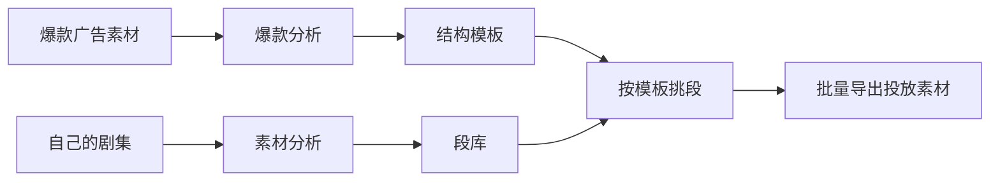

# 🎬 SkyArt 天工

**把跑量的爆款广告拆成可复用的结构模板，再按模板从自己的剧里批量剪出投放素材。**

投放素材的产能卡在两件事上：剪辑师要逐条看完几十分钟的剧集才找得到能用的片段，要复刻一条跑量素材又只能凭印象。SkyArt 把这两件事交给模型：一条素材拆成段，每段标注剧情内容与结构，存进可检索的段库；一条爆款拆成「第几格要什么样的段」的模板；出片时按模板逐格挑段、批量导出。

一台 Mac 上就能跑完，Electron 加 Python 的本地桌面应用，视频不出本机。



## 能做什么

| 模块 | 放进去 | 拿到手 |
|---|---|---|
| **爆款素材分析** | 一条已投放的爆款广告 | 逐段的剧情与结构标注，可存成模板 |
| **素材制作 2.0** | 自己的剧集 + 一个爆款模板 | 每格按模板条件填段，一次导出多条 |
| **素材制作 1.0** | 自己的剧集 | AI 标出高光与钩子，按三种剪辑模式批量合成 |

随包内置 5 个爆款模板，每个都标了出处，例如「3 段滑窗，在 30 条爆款素材里出现 3 次」。

## 一条素材会被拆成什么

分析分六步跑完：认字幕、找镜头、切段、逐段描述、理结构、给段打分。每一段拿到的标注包括：

- **这一段最强的一刻是什么**，以及它出现在第几秒
- **最强的一刻属于哪一类**：冲突、反转、爽点、悬念点
- **主角在这一刻是**施加方还是承受方，**有没有旁人在看**，**阶层落差**有没有
- **尺度档**，从轻到重分档
- 四项打分：抓人速度、撑不撑得住、情绪强度、离开上下文看不看得懂

这些字段既是段库的检索条件，也是模板里每一格写的要求。

## 模板长什么样

一个模板就是几格，每格写清这一格要什么样的段：

```
第 1 格  开场 冲突 主角挨打     锁第一格   最强的一刻要「冲突」，主角是承受方，尺度档 2
第 2 格  中段 反转 主角动手     不锁位置   最强的一刻要「反转」，主角是施加方
第 3 格  结尾 爽点 主角动手     锁最后一格  最强的一刻要「爽点」，主角是施加方
```

导出时，SkyArt 拿这几条去段库里给每一段打分排序，挑出最贴的填进对应的格，再按设定的目标时长拼成成片。一次可以导出多条，每条用不同的段。

素材制作 1.0 不用模板，直接选剪辑模式：

- **高光顺剪** —— 高光开场，接剧情，停在钩子
- **悬疑倒置** —— 悬念开场，再从高光讲起
- **双高光顺剪** —— 两个高光各起一段

## 分析一次要多久、多少钱

| | |
|---|---|
| 耗时 | 5 分钟素材约 6 分钟，一部 1 小时的剧集可以放着跑 |
| 费用 | 平均每分钟素材约 0.05 元，每小时素材约 3 元 |

v1.1.1 对整条分析流程做了多轮对照测试，耗时降低约 40%，费用降低约 50%，分析质量未随之下降。分析过程中界面上能看到当前进行到哪一步、已用多久、还要多久。

## 安装

1. 到 [Releases](../../releases) 下载最新的 `SkyArt-x.x.x-arm64.dmg`。CI 只出 Apple 芯片包，Intel 机器要自己打，见下面的「构建」。
2. 拖进「应用程序」文件夹。
3. 首次打开提示「无法验证开发者」时，终端执行：

```bash
xattr -dr com.apple.quarantine /Applications/SkyArt.app
```

系统要求 macOS 13 Ventura 及以上。ffmpeg 已经打进包里，不用另外装。首次使用要在设置里填 Qwen API Key。

## 构建

推送 `v` 开头的标签触发 GitHub Actions 打包，runner 是 macos-15，产物直接发到 Releases。

```bash
git tag v1.1.1 && git push origin v1.1.1
```

标签名不带 `-beta` 且仓库 Variables 里有 `FEISHU_NOTIFY=true` 时，打包完会往飞书群发一条发版通知。默认不发。

本地打包：

```bash
cd electron-app
npm run pack        # Apple 芯片
npm run pack:x64    # Intel，只能在 Intel 机器上打
```

版本号写在两处，必须一致，否则打包会被 `verify-build.js` 拦下：`electron-app/package.json` 的 `version` 和 `backend/main.py` 的 `APP_VERSION`。

## 本地开发

在浏览器里跑，改完刷新就能看：

```bash
./scripts/dev-web.sh
```

后端起在 8764，前端起在 8088，打开 <http://127.0.0.1:8088/home.html> 即可。浏览器里会用演示账号直接进首页。API Key 取自装好的 app 的配置，没装过 app 就写进 `backend/.env`，格式见 `backend/.env.example`。

数据库默认是 `backend/skyart.db`，和装好的 app 那份（在 Application Support 里）互不影响。

跑 Electron 本体：

```bash
cd backend && .venv/bin/python main.py    # 后端
cd electron-app && npm start              # 前端
```

## 遇到问题

菜单「视图 → 打开日志目录」，把当天的 `backend-YYYYMMDD.log` 发给开发排查。
