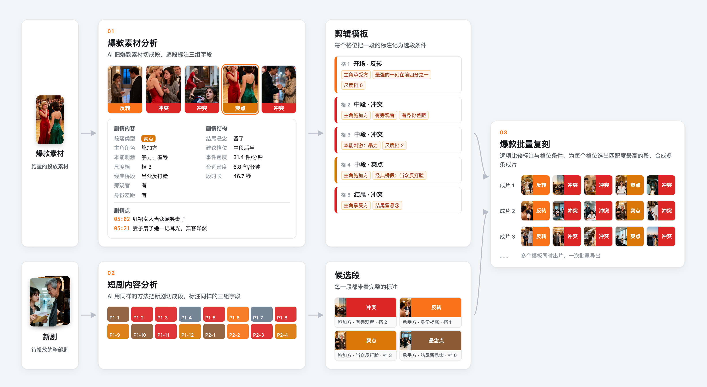

<div align="center">


# SkyArt 天工

**短剧出海投放素材的 AI 剪辑工具：拆解爆款、复刻爆款、批量出片。**


**[▶ 在线演示](https://zdyya.github.io/skyart-showcase/)**

</div>

---

## 💡 项目背景

短剧出海主要通过 Meta、TikTok 等平台的信息流广告获客，每部剧都要剪出投放素材。现有做法有三个问题：

- 剪辑师要看完几十分钟的剧集，才能找到可用的段。
- 剪辑师复刻一条爆款素材时，只能凭印象。
- 市面上的 AI 剪辑工具按产品内置的风格出片，例如截取高光、生成解说。剪辑风格由产品预设或由模型决定，剪辑师无法查看和修改，也不能依据已经跑量的爆款调整。

爆款素材有可复用的结构：开场用哪一类段，冲突怎样升级，结尾停在哪里。SkyArt 把这个结构存为剪辑模板，再按模板从新剧中选段，批量合成成片。达到投放标准的 80 分素材由 AI 批量完成，精品素材由剪辑师制作。

---

## 🧭 工作原理



1. AI 把爆款素材切成段，为每一段写出段落叙述，并标注三组字段：
   - 剧情内容：段落类型、主角角色、本能刺激、尺度档、经典桥段、旁观者、身份差距、场景……
   - 剧情结构：结尾悬念、最强的一刻位置、建议格位、事件密度、台词密度、段时长……
   - 剧情点：时间范围、剧情点类型、这一刻发生的事……
2. 剪辑师选择爆款素材中的段，SkyArt 把它们存为剪辑模板。模板中的每个格位对应一段，选段条件可以精确到字段的取值，例如主角是承受方、最强的一刻在前四分之一、现场有旁观者。
3. AI 用同样的方法把新剧切成段并标注。
4. SkyArt 比较新剧中每一段的标注和每个格位的条件，计算匹配度。
5. SkyArt 为每个格位选择匹配度最高的段，按剪辑模板的顺序合成成片。

---

## 🧪 字段设计

字段表的候选字段来自三个来源，取三者的并集：

1. 媒体平台公布的爆款素材要素：开场钩子、悬念间隔、素材时长……
2. 短剧内容研究中的题材分类和结构分类：段落角色、爽点位置、拼接方式……
3. 模型能从画面和台词中读到的事实：场景、出场人物、旁人在场……

一个字段同时满足以下三个条件，才能进入字段表：

- 模型能准确标注这个字段。
- 这个字段能区分不同的素材。
- 剪辑师能根据这个字段做出具体的剪辑动作。

AI 每标注一处，都写明依据来自画面还是台词，并引用原文。人工根据依据筛选可疑的标注，再对照视频逐帧核对。核对结果用来确定字段的取值和标注规则。

---

## ✨ 核心能力

- 🔍 **爆款素材分析**：剪辑师勾选段后，可以按精简、标准、完整三档决定写入模板的条件数量，也可以逐条增删条件。
- 🎬 **短剧内容分析**：段导轨用颜色显示每一段的段落类型。剪辑师点击一段或一个剧情点，播放器跳到对应的时间。
- 🚀 **爆款批量复刻**：导出前，SkyArt 显示每个格位的候选段数量和最高匹配度，并算出成片数量的上限。剪辑师可以同时选择多个剪辑模板，SkyArt 一次导出全部成片。一条成片中的段不重复，同一段最多用在 3 条成片中。


<sub>短剧内容分析页。截图取自在线演示，基于 v1.1.1 线上界面还原，画面和数据为示例。</sub>

完整操作流程见 **[在线演示](https://zdyya.github.io/skyart-showcase/)**。

---

## 🧰 更多特性

- 📚 **模板库**：SkyArt 内置 5 套剪辑模板，其中 3 套来自爆款素材的段序统计。模板可以导出为 JSON 文件，在其他设备上导入。
- 🎞️ **成片模板**：为成片统一添加片头、片尾、文字、贴纸和特效。

---

## 🗺️ 下一步

- 用剪辑模板出片并投放，再用回收的投放数据校准剪辑模板和匹配规则。

---

## 🔧 技术栈

| 模块 | 技术 |
|---|---|
| 桌面端 | Electron 31 |
| 后端 | Python 3.12、FastAPI、SQLAlchemy、SQLite |
| 视频处理 | FFmpeg 8.1.2 |
| AI 分析 | 多模态大模型（Qwen、Gemini） |
| 打包发布 | PyInstaller、electron-builder、GitHub Actions |

<details>
<summary>📁 项目结构</summary>

```text
SkyArt/
├── electron-app/                     # 桌面端
│   ├── main.js                       # 主进程：启动后端、窗口与菜单
│   └── renderer/
│       ├── home.html                 # 首页
│       ├── tools/hot-analysis/       # 爆款素材分析、模板库
│       └── tools/ad-make/            # 短剧内容分析、批量导出、成片模板
├── backend/                          # Python 后端
│   ├── main.py
│   └── app/
│       ├── routers/                  # 接口
│       ├── services/
│       │   ├── decompose/            # 切段与逐段分析管线
│       │   ├── 取段.py               # 按剪辑模板为每个格位选段
│       │   ├── video.py              # 合成与拼接
│       │   └── postprocess.py        # 成片模板
│       └── data/                     # 内置剪辑模板
├── prompts/                          # 分析用提示词
└── .github/workflows/build.yml       # 推送版本标签后打包并发布
```

</details>

---

## 📦 安装

1. 从 [Releases](../../releases) 下载 `SkyArt-x.x.x-arm64.dmg`。
2. 把 SkyArt 拖入「应用程序」文件夹。
3. 打开 SkyArt。如果系统提示「无法验证开发者」，在终端中执行以下命令：

   ```bash
   xattr -dr com.apple.quarantine /Applications/SkyArt.app
   ```

4. 在首页「设置」中填写模型的 API Key。

系统要求：macOS 13 或更高版本，Apple 芯片。

### 本地开发

1. 执行 `./scripts/dev-web.sh`。
2. 在浏览器中打开 <http://127.0.0.1:8088/home.html>。
